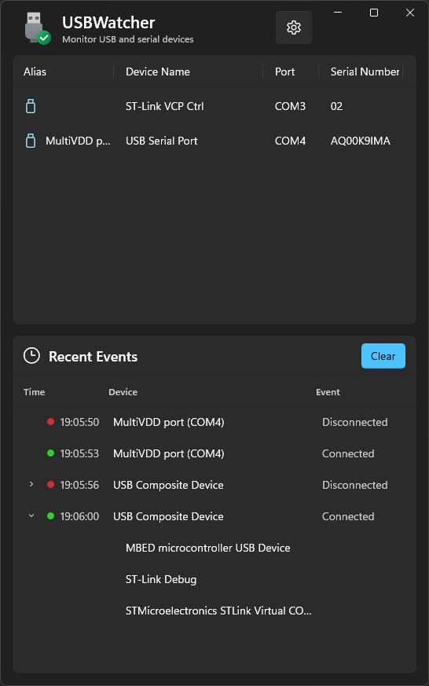
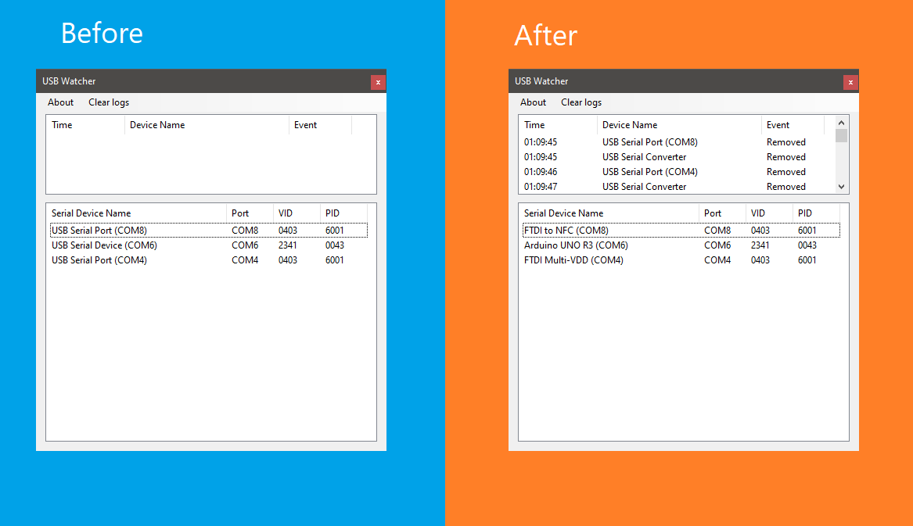
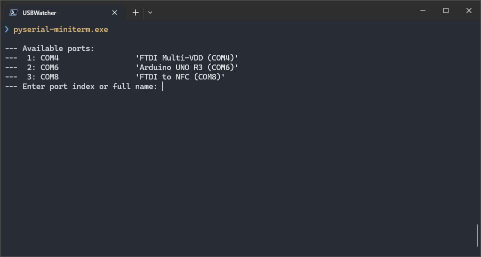

[![Contributors][contributors-shield]][contributors-url]
[![Forks][forks-shield]][forks-url]
[![Stargazers][stars-shield]][stars-url]
[![Issues][issues-shield]][issues-url]
[![MIT License][license-shield]][license-url]

<!-- PROJECT LOGO -->
 

  

<h3 align="center">USBWatcher</h3>

  

    Monitor USB devices, inspect connection events, and assign persistent names to serial ports.
  

## About

USBWatcher is a Windows utility for monitoring USB and serial devices. It keeps
device events organized by physical device, shows the affected descendants,
and lets you replace difficult-to-recognize serial-port names with persistent
names of your own.

  

Serial-port renaming examples

#### Before and after

  

#### Renamed port in another application

The custom name is visible to other applications, such as
[pyserial-terminal](https://pypi.org/project/pyserial/).

  

## Features

- List USB serial devices, COM ports, and FTDI serial numbers.
- Rename devices, restore their default names, and remember custom names across reconnects or port changes.
- Detect connections and removals through native Windows device notifications.
- Monitor external USB devices only or listen to all Windows devices.
- Explore color-coded event trees that group physical devices with their affected descendants.
- Run from the system tray and optionally start automatically at sign-in.
- Choose the modern WinUI interface or the classic WinForms edition.

## Download and installation

  
  <a href="https://github.com/extremegtx/USBWatcher/releases/latest/" style="vertical-align: middle;">Download Latest Release</a>

USBWatcher supports x64 Windows 10 and Windows 11. Each release provides four
choices:

| Package | Recommended for | Updates |
| --- | --- | --- |
| **WinUI Setup** | Most users who want the modern interface | Daily checks with confirmation before download and restart |
| **WinUI Portable ZIP** | A modern app that can be extracted and run directly | Manual through **View latest release** |
| **WinForms Setup** | Users who prefer the classic, lightweight interface | Daily checks with confirmation before download and restart |
| **WinForms Portable ZIP** | A classic app that can be extracted and run directly | Manual through **View latest release** |

Setup installs USBWatcher for the current user. Portable ZIPs require the
[.NET 8 Desktop Runtime](https://dotnet.microsoft.com/en-us/download/dotnet/8.0)
and do not register an uninstaller or shortcuts.

### Why USBWatcher requests administrator access

Windows protects the device registry values used to rename serial devices.
USBWatcher requests UAC approval during a normal launch so renaming and
restoring device names work reliably.

## Updates and network access

Setup editions check GitHub Releases at most once every 24 hours after startup.
They ask before downloading an update and offer **Update and restart** or
**Later**. Network failures during automatic checks stay silent.

Portable editions do not perform automatic update checks or contact the update
feed. Their **View latest release** action opens the releases page in your
browser so you can replace the ZIP manually.

## Development

See [DEVELOP.md](DEVELOP.md) for prerequisites, VS Code tasks, build commands,
and local release packaging.

## Built With

* [![.NET]][.NET-url]
* [![Visual Studio]][VS-url]
* [![Windows]][Windows-url]

## License
Distributed under the MIT License. See `LICENSE.txt` for more information.

## Contact

Mohamed ElShahawi - [@extremegtx](https://twitter.com/extremegtx)

Project Link: [https://github.com/ExtremeGTX/USBWatcher](https://github.com/ExtremeGTX/USBWatcher)

## Acknowledgments

* [Best-README-Template](https://github.com/othneildrew/Best-README-Template/)
* Project icons from [icons8](https://icons8.com/icons/set/usb)

<!-- MARKDOWN LINKS & IMAGES -->
<!-- https://www.markdownguide.org/basic-syntax/#reference-style-links -->
[contributors-shield]: https://img.shields.io/github/contributors/ExtremeGTX/USBWatcher.svg?style=for-the-badge
[contributors-url]: https://github.com/ExtremeGTX/USBWatcher/graphs/contributors
[forks-shield]: https://img.shields.io/github/forks/ExtremeGTX/USBWatcher.svg?style=for-the-badge
[forks-url]: https://github.com/ExtremeGTX/USBWatcher/network/members
[stars-shield]: https://img.shields.io/github/stars/ExtremeGTX/USBWatcher.svg?style=for-the-badge
[stars-url]: https://github.com/ExtremeGTX/USBWatcher/stargazers
[issues-shield]: https://img.shields.io/github/issues/ExtremeGTX/USBWatcher.svg?style=for-the-badge
[issues-url]: https://github.com/ExtremeGTX/USBWatcher/issues
[license-shield]: https://img.shields.io/github/license/ExtremeGTX/USBWatcher.svg?style=for-the-badge
[license-url]: https://github.com/ExtremeGTX/USBWatcher/blob/main/LICENSE.txt
[VS-url]: https://visualstudio.microsoft.com/
[.NET-url]: https://dotnet.microsoft.com/en-us/download/dotnet/8.0
[Windows-url]: https://www.microsoft.com/en-us/windows
[.NET]: https://img.shields.io/badge/.NET-5C2D91?style=for-the-badge&logo=.net&logoColor=white
[Visual Studio]: https://img.shields.io/badge/Visual%20Studio-5C2D91.svg?style=for-the-badge&logo=visual-studio&logoColor=white
[Windows]: https://img.shields.io/badge/Windows-0078D6?style=for-the-badge&logo=windows&logoColor=white
